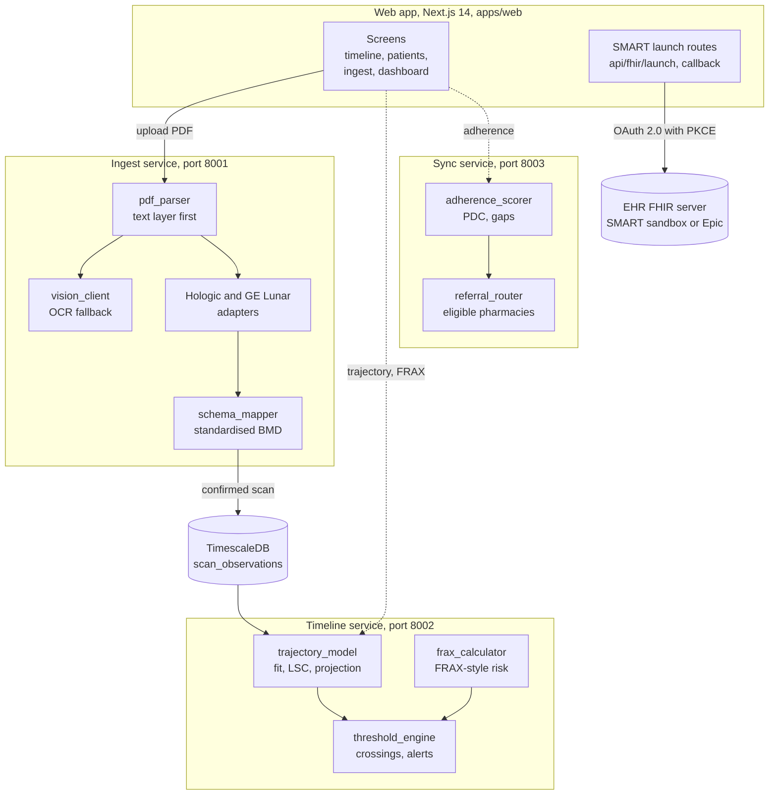

# Boensity, explained

This is a plain-language guide to what Boensity is, why it exists and how it is built. You do not need a background in healthcare or software to follow it. Technical terms are explained the first time they appear, and every term is in the [glossary](#glossary) at the end. For a longer explanation of the health IT standards mentioned here, see the [Health IT primer](https://github.com/Henrycarto/passayge/blob/main/docs/HEALTH_IT_PRIMER.md).

## In one sentence

Boensity reads a patient's old bone density reports, puts the numbers from different scanners on one comparable scale, draws the line through them, and tells the doctor when that line will reach the osteoporosis threshold and what the fracture risk will be.

## In one paragraph

Osteoporosis is a disease in which bones slowly lose density until they break easily. It is measured with a DEXA scan, a low-dose X-ray that produces a number called the T-score. Each report says where the patient is today, but not how fast they are moving: two people at the same T-score can have very different futures if one has been stable for years and the other is losing bone quickly. The older reports usually exist, but they are scattered across PDF files from different hospitals and different scanner makers, whose numbers are not directly comparable. Boensity is a software platform with three services. **Ingest** reads DEXA report PDFs from the two main scanner makers (Hologic and GE Lunar) and converts their values onto one standard scale. **Timeline** stores the history, fits a straight line through it, checks whether the change is bigger than the scanner's own measurement noise, projects it forward and computes a ten-year fracture probability with a FRAX-style calculation (an independent re-implementation of the published method, not the certified FRAX tool). **Sync** checks whether the patient is actually collecting their osteoporosis medicine. A web front end shows the result as a chart, and connects to a hospital record system through SMART on FHIR, the standard way for an app to log in to an electronic health record. It matters because bone loss is slow, measurable and treatable, so a trend that is visible years in advance is a chance to treat before the first fracture.

## The real-world problem

### A short story

Gerda Lindner is 66 and lives in a mid-sized town. (She is fictional, like every patient in Boensity.) She had her first DEXA scan in 2014 at the regional hospital: T-score minus 1.1, "slightly low bone mass, repeat in a few years". In 2017 it was minus 1.5 on the same Hologic scanner. Then the hospital replaced the machine, and her 2020 and 2023 scans were done on a GE Lunar: minus 1.9 and minus 2.2.

Each report was read once, filed, and described the same way: "osteopenia, repeat scan". Nobody drew the line. Three questions are hard to answer from the paper:

1. **Is she actually losing bone, or did the new scanner just read differently?** Hologic and GE Lunar machines give different numbers for the same bone, so a step between 2017 and 2020 could be the hardware.
2. **How fast, and is it more than measurement noise?** A DEXA scanner has a known precision error; a small change can be pure noise.
3. **When does she reach the osteoporosis line at minus 2.5, and how likely is a fracture in the next ten years?** That is the number a doctor uses to decide on treatment.

Boensity's demo patient BN-1157 follows exactly this pattern. With her four scans, the engine reports a loss of about 0.12 T-score units a year, a projected crossing of minus 2.5 about 2.25 years after her last scan, a ten-year probability of a major osteoporotic fracture of 22.1 percent and of a hip fracture of 6.5 percent, and a warning that the series mixes two manufacturers.

### What goes wrong

- **The history is scattered.** Earlier scans sit in PDFs and faxes from different places. Reading them by hand is slow, and nobody does it for every patient.
- **Scanners disagree.** Different manufacturers measure the same bone differently and compare it to different reference groups, so their T-scores cannot be plotted on one line without a correction (see [manufacturer-normalization.md](manufacturer-normalization.md)).
- **Noise looks like a trend.** A change smaller than the scanner's least significant change is not real, but a naive chart would show it as decline.
- **The report shows a position, not a direction.** The standard report gives one number and a band. It does not say when the patient will cross into osteoporosis.
- **Treatment only works if it is taken.** Roughly half of patients started on an oral osteoporosis drug stop within a year, according to the project's own documentation ([architecture.md](architecture.md)); this figure is not sourced in the repo.

Boensity addresses each one: it reads the PDFs, standardises the values across scanners, judges every trend against the noise floor, projects the line with its uncertainty, and tracks whether prescriptions are being filled.

## The healthcare background you need

Short definitions follow. The [Health IT primer](https://github.com/Henrycarto/passayge/blob/main/docs/HEALTH_IT_PRIMER.md) explains several of them (DEXA and T-scores, FRAX, FHIR, SMART on FHIR, LOINC, EU MDR) in more depth.

**Osteoporosis.** A disease in which bones lose mineral and structure until they become fragile and break from a minor fall, typically at the hip, spine or wrist. It is common in older women and develops silently for years; the first sign is often a fracture. Medicines can slow the loss or rebuild bone. Think of a wooden beam slowly being eaten from the inside: it looks fine until it gives way.

**Bone mineral density (BMD).** How much mineral is packed into a given area of bone, measured in grams per square centimetre (g/cm2). Lower density means weaker bone. Think of the density of a sponge: the more holes, the easier it is to squash.

**DEXA (dual-energy X-ray absorptiometry, also DXA).** The standard scan for measuring BMD. The patient lies on a table while two low-dose X-ray beams of different energy pass through the hip, the lower spine and sometimes the forearm; comparing how much each beam is absorbed gives the bone density. The scanner prints a report with a table: one row per body region (for example "Neck" for the femoral neck, the narrow part of the thigh bone just below the hip joint), with BMD, T-score and Z-score columns. Think of weighing something by seeing how much light it blocks.

**T-score.** How far a patient's BMD is from the average of healthy young adults of the same sex, counted in standard deviations (a statistical unit of spread). A T-score of 0 is young adult average; minus 1 is one standard deviation below it. Under the World Health Organization (WHO) 1994 definition, minus 1 or above is normal, between minus 1 and minus 2.5 is osteopenia (low bone mass) and minus 2.5 or lower is osteoporosis (`classify_band()` in [trajectory_model.py](../services/timeline/app/engine/trajectory_model.py)). Think of a school grade measured as "how many steps below the class average".

**Z-score.** Like a T-score, but compared with people of the same age instead of young adults. Boensity reads it from reports and keeps it, but the calculations use the T-score.

**Precision error and least significant change (LSC).** Scan the same person twice and the scanner gives slightly different numbers. The least significant change is the smallest difference that is probably real, set by the International Society for Clinical Densitometry (ISCD) at 2.77 times the precision error. A change smaller than that is noise. Think of a bathroom scale that wobbles by half a kilo: losing 200 grams means nothing.

**Manufacturer differences and standardised BMD (sBMD).** Hologic and GE Lunar machines read the same bone differently, and each compares against its own reference database. Published cross-calibration studies scanned the same patients on several machines and produced conversion formulas into a common unit, standardised BMD, in mg/cm2. Think of converting Fahrenheit and Celsius thermometer readings to one scale before you draw a temperature chart.

**Fracture risk and FRAX.** FRAX is a tool from the University of Sheffield that estimates a person's ten-year probability of a major osteoporotic fracture (spine, hip, forearm or upper arm) and of a hip fracture. It combines age, sex, weight, height, previous fracture, a parent's hip fracture, smoking, steroid (glucocorticoid) use, rheumatoid arthritis, secondary osteoporosis, alcohol and, optionally, femoral neck BMD, and it is calibrated separately for each country. Guidelines set treatment thresholds on its output; Boensity uses the US Bone Health and Osteoporosis Foundation (BHOF) thresholds of 20 percent major and 3 percent hip (`INTERVENTION_THRESHOLD_MAJOR` and `INTERVENTION_THRESHOLD_HIP` in [frax_calculator.py](../services/timeline/app/engine/frax_calculator.py)). **Important:** Boensity does not use the certified FRAX tool. The official coefficients are not published, so Boensity re-implements the published method with European reference rates, and every answer carries a `calibration_note` saying it is not the certified tool. Think of a weather forecast for bones: a probability, not a certainty.

**Competing mortality.** Over ten years, some older patients will die of other causes before they could fracture. A correct fracture probability has to account for that, otherwise it overstates risk in the very old. Think of the odds of a car needing a new clutch: they are lower if the car may be scrapped first.

**Osteoporosis medicines.** The two named in the code are oral bisphosphonates (for example alendronate, a weekly or daily tablet) and denosumab (an injection every six months). Boensity applies trial-based reductions in fracture risk to show the treated probability next to the untreated one (`_TREATMENT_EFFICACY` in [frax_calculator.py](../services/timeline/app/engine/frax_calculator.py)).

**Adherence and proportion of days covered (PDC).** Whether a patient takes their medicine as prescribed. PDC is the standard pharmacy measure: the share of days in a period on which the patient had medicine at home, based on pharmacy fill records. 80 percent or more is "adherent". Think of a gym membership: paying for it is not the same as going, and PDC counts the days you actually had access.

**EHR, FHIR and SMART on FHIR.** An EHR (electronic health record) is the hospital's patient record system, for example Epic. FHIR (Fast Healthcare Interoperability Resources) is the modern HL7 standard for exchanging health data over the web as small JSON documents called resources, such as Patient or Observation. SMART on FHIR is the standard way for an outside app to log in to an EHR with OAuth 2.0 (the "log in with" protocol used across the web) and get a short-lived, limited permission to read FHIR data. PKCE (Proof Key for Code Exchange) is a one-time secret that stops a stolen login code from being used by someone else. Think of a hotel key card that opens only your room, and only until checkout.

**LOINC.** A catalogue of codes for measurements, so "femoral neck BMD" is `24701-5` everywhere. The SMART client lists the LOINC codes Boensity would read from an EHR (`LOINC` in [packages/fhir-client/src/index.ts](../packages/fhir-client/src/index.ts)).

## What it does, step by step

Here is one full journey, through the screens and the services underneath. Ports are the local defaults from [infra/docker-compose.yml](../infra/docker-compose.yml).

1. **A clinician connects to the hospital's record system.** The login page ([apps/web/app/(auth)/login/page.tsx](<../apps/web/app/(auth)/login/page.tsx>)) has no Boensity password. It starts a SMART on FHIR launch at `/api/fhir/launch`. The server fetches the record system's `.well-known/smart-configuration` document to learn its login and token addresses, creates a PKCE secret and a random `state` value, stores them in an httpOnly cookie (one that page scripts cannot read) for 10 minutes, and redirects the browser to the record system's login. Two record systems are configured: the public SMART reference sandbox and Epic's public FHIR R4 sandbox ([issuers.ts](../packages/fhir-client/src/issuers.ts)).
2. **The record system sends the clinician back.** `/api/fhir/callback` checks the `state`, exchanges the code plus the PKCE secret for an access token, stores the session in another httpOnly cookie, and redirects to the patient's timeline when the token names a patient.
3. **A DEXA report is uploaded.** On the ingest screen ([apps/web/app/ingest/page.tsx](../apps/web/app/ingest/page.tsx)) the clinician drops one or more PDFs. The Ingest API accepts a patient id and the patient's sex with each file (the sex is needed for standardisation); the current ingest screen does not yet send either, so its scans arrive without them. The Ingest service (port 8001) checks the file really starts with `%PDF-` and is at most 25 MB.
4. **The text is read.** `parse_pdf()` reads the PDF's built-in text layer with pdfplumber. If there are fewer than 120 characters per page, the PDF is treated as a scanned image and sent to Google Cloud Vision for OCR (optical character recognition); without Vision credentials, such a file is refused with a clear message.
5. **The manufacturer is identified.** Both the Hologic and the GE Lunar adapters score the text against a weighted keyword list; the higher score wins, and a score under 0.25 is recorded as "unknown" rather than guessed.
6. **The results table is read.** The matching adapter reads each row (femoral neck, total hip, lumbar spine, forearm), the scan date, the scanner model and a patient reference. Every value keeps its confidence and the exact text it came from.
7. **The values are standardised.** `normalize()` in [schema_mapper.py](../services/ingest/app/engine/schema_mapper.py) converts the vendor BMD into standardised BMD and recomputes the T-score against one sex-specific young adult reference. Both the printed T-score and the recomputed one are kept.
8. **A human checks it.** The review pane shows what was read next to where it was read. Anything uncertain (low confidence, unknown manufacturer, missing date, missing sex, ambiguous date order) is marked "requires review" with reasons. Only when the clinician confirms does `/confirm` send the scan to the Timeline service, and it refuses a scan that has no patient id.
9. **The scan is stored.** Timeline (port 8002) writes it to a TimescaleDB table with `POST /scans`. Uploading the same report twice updates the row instead of adding a second point.
10. **The trajectory is computed.** `POST /trajectory` fits a straight line through the T-scores over time, checks the total change against the least significant change, projects the line forward (10 years by default) with a 95 percent prediction interval, finds where it crosses minus 1 and minus 2.5, computes the FRAX-style probability, and builds a list of alerts ordered by severity.
11. **The doctor sees the chart.** The timeline screen ([apps/web/app/patients/[id]/timeline/page.tsx](<../apps/web/app/patients/[id]/timeline/page.tsx>)) shows the scans, the projected line with its widening band, the osteoporosis threshold, the crossing date, the risk today with and without treatment, and the adherence panel.
12. **Adherence is checked.** The Sync service (port 8003) scores pharmacy fill records: PDC, gaps of 30 days or more, and a band (adherent, partial, non-adherent, lapsed). If a referral to another pharmacy is clinically indicated, it lists eligible pharmacies. Without pharmacy credentials it runs on recorded fixture data and says so.

The patient list, patient record, dashboard and timeline screens currently show a demo cohort of five synthetic patients whose numbers were computed by the real engine ([scripts/generate_demo_fixtures.py](../scripts/generate_demo_fixtures.py)). The ingest screen talks to the live Ingest service.

## How it is built

Dotted arrows are calls the web app's API client defines ([lib/api.ts](../apps/web/lib/api.ts)) but its screens do not make yet: they show demo fixtures that the same Timeline and Sync code generated. Supporting pieces not drawn: Redis and a Celery worker run extraction in the background, MinIO (locally) or Amazon S3 (in the Terraform) stores the uploaded PDFs, and the Terraform describes the AWS deployment.

### The parts

| Part | What it is | Why it exists | Talks to |
|---|---|---|---|
| **Web app** ([apps/web](../apps/web)) | Next.js 14 App Router front end: landing page, patient list sorted by rate of loss, patient record, timeline, ingest review, department dashboard, login. | So a clinician can see the trajectory and check the machine's work. | The Ingest service through [lib/api.ts](../apps/web/lib/api.ts), which also defines Timeline and Sync calls; the EHR through the SMART routes. |
| **SMART on FHIR client** ([packages/fhir-client/src/index.ts](../packages/fhir-client/src/index.ts), [issuers.ts](../packages/fhir-client/src/issuers.ts)) | Discovery with a one-hour cache, PKCE, the authorize URL, code exchange, refresh, and a small FHIR client for Patient and Observation reads. | One implementation shared by the web app and the Epic smoke script. | The EHR's authorization and FHIR endpoints. |
| **Session handling** ([apps/web/lib/fhir.ts](../apps/web/lib/fhir.ts)) | `beginSmartLaunch()`, `completeSmartLaunch()`, `getAuthenticatedClient()`, with the PKCE verifier and tokens in httpOnly cookies. | Keeps the verifier and token out of browser JavaScript. | The SMART client package. |
| **PDF reader** ([services/ingest/app/engine/pdf_parser.py](../services/ingest/app/engine/pdf_parser.py)) | Reads the text layer with word positions and groups words into lines. | Text layers are exact and free; OCR is approximate and billed. | The adapters. |
| **OCR client** ([vision_client.py](../services/ingest/app/engine/vision_client.py)) | Google Cloud Vision, synchronous for up to 5 pages, asynchronous through a storage bucket above that. | For scanned or faxed reports with no text layer. | Google Cloud, only when credentials are set. |
| **Vendor adapters** ([hologic_adapter.py](../services/ingest/app/engine/hologic_adapter.py), [ge_lunar_adapter.py](../services/ingest/app/engine/ge_lunar_adapter.py), shared [adapter_base.py](../services/ingest/app/engine/adapter_base.py)) | Detect the manufacturer and read its table layout, dates and scanner model. | The two layouts have different traps (see hard part 2). | The schema mapper. |
| **Schema mapper** ([schema_mapper.py](../services/ingest/app/engine/schema_mapper.py)) | Picks the adapter, converts BMD to standardised BMD, recomputes the T-score, decides whether a human must review. | Makes scans from different scanners comparable. | The upload router. |
| **Upload router and worker** ([routers/upload.py](../services/ingest/app/routers/upload.py), [tasks/ocr_job.py](../services/ingest/app/tasks/ocr_job.py)) | `/upload` (background job), `/jobs/{id}`, `/extract` (immediate preview) and `/confirm`. Both paths call one `run_pipeline()`. | Background when a document is uploaded, immediate when a clinician is waiting on the review screen; one pipeline so the two cannot give different numbers. | Storage, Celery and Redis, the Timeline service. |
| **Trajectory model** ([services/timeline/app/engine/trajectory_model.py](../services/timeline/app/engine/trajectory_model.py)) | `fit_trajectory()`, `least_significant_change()`, `build_velocity_report()`, `project_points()`, `describe_model_quality()`. | Turns scans into a rate, a direction and a projection with uncertainty. | Threshold engine, routers. |
| **FRAX-style calculator** ([frax_calculator.py](../services/timeline/app/engine/frax_calculator.py)) | `calculate_frax()`, `apply_treatment()`, `meets_intervention_threshold()`. | Gives the ten-year probability a doctor already knows how to act on. | Trajectory and FRAX routers. |
| **Threshold engine** ([threshold_engine.py](../services/timeline/app/engine/threshold_engine.py)) | `detect_crossing()` solves where the line meets minus 1 and minus 2.5; `build_alerts()` produces the alerts. | Turns a chart into clinical events, each with a confidence grade. | The trajectory router. |
| **Timeline API and store** ([routers/](../services/timeline/app/routers), [db.py](../services/timeline/app/db.py), [migrations/001_init_timescale.sql](../services/timeline/migrations/001_init_timescale.sql)) | `/trajectory`, `/trajectory/velocity`, `/frax`, `/frax/projected`, `/scans`; asyncpg queries; the hypertable schema. | Stores the history and serves every derived number. | TimescaleDB. |
| **Adherence scorer** ([services/sync/app/engine/adherence_scorer.py](../services/sync/app/engine/adherence_scorer.py)) | PDC, medication possession ratio, gaps, bands; a hook for a private risk score. | A risk reduction only holds if the medicine is taken. | Pharmacy client, referral router. |
| **Referral router and pharmacy client** ([referral_router.py](../services/sync/app/engine/referral_router.py), [pharmacy_client.py](../services/sync/app/engine/pharmacy_client.py)) | Decides on clinical grounds whether a referral is indicated, filters eligible pharmacies; fixture driver without credentials. | Separates clinical eligibility (public) from commercial ranking (private, not in the repo). | A pharmacy network API, when one is connected. |
| **Infrastructure** ([infra/docker-compose.yml](../infra/docker-compose.yml), [infra/terraform](../infra/terraform)) | Local stack of nine containers; AWS design with a VPC, ECS Fargate on ARM64, RDS PostgreSQL 16.4, S3 with KMS encryption, a load balancer. | One command locally; a written plan for the cloud. | Everything above. |

## The technology stack

Versions come from `package-lock.json`, the `requirements.txt` files, the Dockerfiles and the Terraform.

| Item | Version | What it does here | Why this one |
|---|---|---|---|
| Python | 3.12 (Docker `python:3.12-slim`, CI) | Language of the three services. | Not recorded in the repo: not confirmed. A reasonable reading: NumPy and SciPy for the statistics, pdfplumber for PDFs. |
| FastAPI | 0.115.0 | HTTP framework of each service. | Not recorded in the repo: not confirmed. |
| Pydantic | 2.9.2 | Validates every request and response, for example age 40 to 90 for FRAX. | Comes with FastAPI; the range checks encode clinical limits. |
| NumPy, SciPy | 2.1.1, 1.14.1 | Line fitting and the Student t values for confidence and prediction intervals. | Standard numerical libraries. |
| pdfplumber | 0.11.4 | Reads PDF text layers with word positions. | Keeps positions, which the table reading needs ([pdf_parser.py](../services/ingest/app/engine/pdf_parser.py)). Comparison with other PDF libraries: not confirmed. |
| Google Cloud Vision | 3.7.4 | OCR fallback for scanned reports. | Not recorded in the repo why Vision over other OCR engines: not confirmed. |
| Celery with Redis | 5.4.0, Redis 5.0.8 client, `redis:7.4-alpine` | Background extraction jobs. | Not recorded in the repo: not confirmed. |
| boto3 and MinIO | 1.35.24, MinIO `RELEASE.2024-09-22` | PDF storage, S3 compatible, with 15-minute pre-signed links. | MinIO stands in for S3 locally. |
| asyncpg | 0.29.0 | Database access from Timeline. | Chosen over an ORM because the queries are narrow and use TimescaleDB functions an ORM does not carry ([db.py](../services/timeline/app/db.py)). |
| TimescaleDB on PostgreSQL | `timescale/timescaledb:2.17.2-pg16` locally; RDS PostgreSQL 16.4 in Terraform | Stores scans in a hypertable (time-partitioned table) with one-year chunks, a monthly continuous aggregate and compression after five years. | [architecture.md](architecture.md): the department query sweeps every patient across a time window, which is what time partitioning is built for. |
| Next.js | 14.2.35 | Web app and the SMART server routes. | Not recorded in the repo: not confirmed. |
| React | 18.3.1 | User interface. | Comes with Next.js 14. |
| D3 | 7.9.0 | Draws the fracture risk chart ([lib/d3-chart.ts](../apps/web/lib/d3-chart.ts)). | [architecture.md](architecture.md): the threshold band, crossing point and widening interval are the content, and a charting library would need fighting on each. |
| Tailwind CSS, Radix UI | 3.4.19, Radix dialog 1.1.23 | Styling and accessible building blocks. | Not recorded in the repo: not confirmed. |
| TypeScript | 5.9.3 | Language of the web app and SMART client. | Not recorded in the repo: not confirmed. |
| Turborepo with npm workspaces | turbo 2.10.10, npm 10.9.8 | Runs build, lint, typecheck and test across `apps/*` and `packages/*`. | Not recorded in the repo: not confirmed. |
| Node test runner with tsx | Node 22 (CI), tsx 4.23.15 | Runs the 27 SMART client tests. | Built into Node; no extra test framework. Reason not recorded: not confirmed. |
| pytest, pytest-asyncio, reportlab | 8.3.3, 0.24.0, 4.2.2 | Python tests; reportlab generates synthetic DEXA PDFs for the adapter tests. | Tests run the real PDF code path instead of a mock ([architecture.md](architecture.md)). |
| Ruff | 0.6.8 | Python lint and format check ([ruff.toml](../ruff.toml)). | Not recorded in the repo: not confirmed. |
| Docker Compose | compose file in `infra/` | Local stack: TimescaleDB, Redis, MinIO, three services, worker, web. | One command to run everything. |
| Terraform with the AWS provider | Terraform 1.9.5 in CI, `>= 1.7.0` required, AWS provider `~> 5.60` | Describes the AWS deployment. Validated in CI, never applied. | Not recorded in the repo why AWS: not confirmed. |
| GitHub Actions | `ci.yml`, `deploy.yml` | CI with 12 jobs; a manual-only deploy workflow. | Runs on every push and pull request to `main`. |
| Vercel | `vercel.json` | Deploys the web app (only the web app) from the monorepo. | Not recorded in the repo: not confirmed. |

## The hard parts and how they were solved

### 1. Scanners from different makers give different numbers

**Problem.** A Hologic and a GE Lunar scanner measure the same hip and print different BMD values, and they compute T-scores against different reference groups. If a clinic replaces its scanner, the patient's line shows a step that is the hardware, not the patient. Every later number (rate, crossing date, alert) would be wrong.

**Solution.** Both effects are removed in one pass. The vendor BMD is converted into standardised BMD with published cross-calibration formulas per site and manufacturer, for example femoral neck Hologic `1000 x (1.013 x BMD + 0.002)` and GE Lunar `1000 x (0.939 x BMD + 0.032)`. The T-score is then recomputed against one sex-specific young adult reference in the same unit (femoral neck, women: mean 871.0, standard deviation 121.6 mg/cm2). Both T-scores are kept: the printed one, because it is what the patient's paper says, and the recomputed one, which is the only one valid to plot across scanners. If they differ by more than 0.5, a note asks the reviewer to check the BMD. Without BMD, a known manufacturer or the patient's sex, the printed T-score is kept and the scan is forced into review. Because the formulas carry 2 to 3 percent residual error (about 0.2 T-score units at the femoral neck, per the docs), a mixed-manufacturer series stays flagged all the way to the chart.

**Where.** `_STANDARDIZATION`, `_YOUNG_ADULT_REFERENCE`, `standardize_bmd()`, `t_score_from_sbmd()` and `normalize_measurement()` in [schema_mapper.py](../services/ingest/app/engine/schema_mapper.py); `describe_model_quality()` in [trajectory_model.py](../services/timeline/app/engine/trajectory_model.py) and the `mixed_manufacturer_series` alert in [threshold_engine.py](../services/timeline/app/engine/threshold_engine.py). Tested in [test_adapters.py](../services/ingest/tests/test_adapters.py): "the two vendors converge after standardisation", "a scanner change does not create a phantom step", "men are scored against a male reference".

### 2. Reading vendor report tables without mistakes that flip a diagnosis

**Problem.** Report tables look simple but hide traps. On a Hologic report the word "Total" means the whole hip on a hip table and the lumbar spine (L1 to L4) on a spine table. A GE Lunar report has an "Upper Neck" region that is not the femoral neck, and puts percentage columns between the two scores. Minus signs can arrive as different Unicode dash characters, and a lost sign turns minus 2.5 (osteoporosis) into plus 2.5. European consoles print the day first and US consoles the month first.

**Solution.** Values are recognised by the range they must fall in rather than by column position: BMD between 0.1 and 2.5, scores between minus 8 and plus 6, so percentages of 50 to 130 are skipped. "Total" is decided by whether the current table is a spine or a hip table. Site labels use the longest match, so "upper neck" is claimed (and then ignored) before "neck" can match. All dash variants are turned into a plain minus before parsing. On GE Lunar reports, a date like 06.07.2021, where both parts are 12 or less, is flagged as ambiguous rather than guessed, because a swapped month reorders the trajectory. Every value carries a confidence: 0.97 from a text layer, at most 0.94 from OCR, and a date without a nearby label is cut to 60 percent of the base confidence; below 0.80 the scan needs review.

**Where.** `normalise_minus()`, `parse_date()`, `numeric_tokens()`, `site_from_label()` and `base_confidence()` in [adapter_base.py](../services/ingest/app/engine/adapter_base.py); `_spine_total_is_lumbar()` in [hologic_adapter.py](../services/ingest/app/engine/hologic_adapter.py); `_IGNORED_REGIONS` and `_extract_measurement()` in [ge_lunar_adapter.py](../services/ingest/app/engine/ge_lunar_adapter.py). Tested end to end from real PDF bytes that reportlab builds ([conftest.py](../services/ingest/tests/conftest.py)): "spine total maps to lumbar not hip", "upper neck is not treated as femoral neck", "percentage columns are not mistaken for scores", "negative scores keep their sign", "ambiguous date order is flagged".

### 3. Telling real bone loss from scanner noise, and saying how sure the projection is

**Problem.** Serial DEXA gives few points over many years, and each point has measurement error. A naive line through three noisy points can look like decline, raise an alarm and destroy trust in the alerts. Two points always fit a line perfectly, which says nothing about certainty.

**Solution.** The line is a simple ordinary least squares fit of T-score against years, because a more flexible curve would chase noise. The total change over the observed span is compared with the least significant change for the site (2.77 x precision error x young adult mean BMD / young adult SD, which gives 0.32 T-score units at the femoral neck). Below it the trend is reported as "stable", whatever the slope. With two scans there is no R squared and no confidence interval; with one scan the line uses a population average rate and is labelled as such. The forward projection carries a 95 percent prediction interval (the range a future measurement could fall in, which is wider than the interval for the line itself) that widens with distance. Each threshold crossing is solved exactly from the line and graded high, moderate or low depending on the number of scans, the span and whether the slope's confidence interval still contains zero.

**Where.** `fit_trajectory()`, `least_significant_change()`, `build_velocity_report()`, `TrajectoryFit.prediction_interval()` in [trajectory_model.py](../services/timeline/app/engine/trajectory_model.py); `_crossing_confidence()` and `detect_crossing()` in [threshold_engine.py](../services/timeline/app/engine/threshold_engine.py). Tested in [test_trajectory_model.py](../services/timeline/tests/test_trajectory_model.py) and [test_api.py](../services/timeline/tests/test_api.py); demo patient BN-8810 (minus 1.50 to minus 1.55 over six years) is reported as "change inside the measurement noise floor".

### 4. A fracture probability that behaves like FRAX without the certified tool

**Problem.** Doctors act on FRAX numbers, but the official FRAX coefficients and country calibrations are not published. A home-made score would ask clinicians to trust a new scale. Re-implementing FRAX also has known traps that make every patient read too high.

**Solution.** An independent implementation of the published method. For each of the ten years it combines a fracture hazard and a death hazard, so a patient who dies cannot fracture (competing mortality), evaluated at the middle of each year. Baseline rates are European reference tables by age and sex. Clinical risk factors multiply the risk, with a separate factor for hip and for major fracture, and part of each factor is removed when a bone density value is given (secondary osteoporosis drops out completely). The bone density effect is measured from the average T-score of people of the same age and sex, not from the young adult average; the handoff document records that scoring against the young adult average gave a healthy 65-year-old woman 20 percent instead of the published 11 percent. The effect per standard deviation weakens with age (hip: 3.68 at 50, 1.71 at 85). T-scores are clamped to minus 4 to plus 2, and hip probability is capped at the major probability. The result is labelled in every response as not the certified tool, and the projected version recomputes the probability at future ages with the projected T-score, stopping at 90.

**Where.** `_ten_year_probability()`, `assemble_relative_risks()`, `_bmd_relative_risk()`, `_MEAN_FEMORAL_NECK_T_SCORE`, `CALIBRATION_NOTE` in [frax_calculator.py](../services/timeline/app/engine/frax_calculator.py); `/frax/projected` in [routers/frax.py](../services/timeline/app/routers/frax.py); method and limits in [frax-methodology.md](frax-methodology.md). Guarded by `TestCalibration` in [test_frax_calculator.py](../services/timeline/tests/test_frax_calculator.py), which checks a woman with no risk factors against reference values at eight ages (50 to 85) within 2 percentage points. In my run the largest deviation was 1.1 points (age 75: 16.1 percent against 15.0 percent major). Which published FRAX country model the reference values come from is not stated in the repo: not confirmed.

### 5. "Absent" must never look like "zero"

**Problem.** Some inputs are missing by design: the composite adherence risk score and the pharmacy ranking live in a private package that is not in the repository, and OCR or pharmacy credentials may not be set. A default of 0 for a missing risk score would read as "no risk", and picking the first pharmacy in a list would pass list order off as a recommendation.

**Solution.** Each service works without its optional parts and says so. The private package is imported inside a `try` block; without it, `risk_score` is `None` and `risk_score_available` is `false`, and no pharmacy is preselected. `/health` on each service reports what is missing (`ocr_available`, `live_pharmacy_connection`, private scoring and routing). Fixture pharmacy data is labelled as not live. Every endpoint returns the same `{data, error, meta}` envelope even on errors, and unexpected exceptions are logged but never returned, because exception text can contain patient values. Pharmacy feeds that record a six-monthly denosumab injection with a supply of 1 day are corrected to 180 days, which would otherwise score a perfectly adherent patient at almost 0 percent.

**Where.** `compute_risk_score()` and `EXPECTED_COVERAGE_DAYS` in [adherence_scorer.py](../services/sync/app/engine/adherence_scorer.py); `rank_candidates()` and `route()` in [referral_router.py](../services/sync/app/engine/referral_router.py); exception handlers in each `app/main.py`. Tested in [test_adherence.py](../services/sync/tests/test_adherence.py): "risk score is absent without the private package", "no pharmacy is preselected without private ranking", "denosumab days supply of one is corrected", "health reports every degraded capability". CI fails if `boensity_sync_private` is ever committed.

## How we know it works

Counts below are from my own runs on 24 October 2026 on Windows, with Python 3.12.7 in a temporary virtual environment and Node 22.22.3, at commit `def561c`. Every suite that ran passed.

| Suite | Command | Tests | What it proves |
|---|---|---|---|
| Timeline | `pytest tests` in `services/timeline` | 81 passed | The trajectory fit, LSC, projection and prediction interval; crossings and alerts; the FRAX-style calculation, its calibration at eight ages, risk factors, BMD effect, competing mortality, treatment; the API envelope and validation. |
| Ingest | `pytest tests` in `services/ingest` | 38 passed | Reading synthetic Hologic and GE Lunar PDFs end to end; manufacturer detection; the table traps; standardisation and convergence across vendors; review rules; OCR confidence lower than text layer. |
| Sync | `pytest tests` in `services/sync` | 36 passed | PDC, MPR, gaps, bands, the injectable correction, drug classification, referral indication, eligibility, degradation without the private package, the API. |
| SMART client | `node --import tsx --test "test/**/*.test.ts"` in `packages/fhir-client` | 23 passed, 0 failed | PKCE challenge against the RFC 7636 example, state and verifier format, the authorize URL parameters, discovery with caching and refusal of servers without S256, issuer profiles, the launch verification reads. |
| Epic sandbox | same command with `EPIC_CLIENT_ID` set | 4, not run | The suite skips itself without a registered Epic client id, as it does in CI. It checks Epic's live smart-configuration and the authorize URL; it cannot log in. |

That is 155 Python tests and 23 TypeScript tests, all passing. Ruff lint and format checks also passed for all three services. I regenerated the demo fixtures with both scripts in `scripts/`; the only difference from the committed files was Windows line endings, so the fixtures match the engine.

Not run locally: the web app typecheck, lint and production build, and the Docker image builds, because `node_modules` is not installed and a full install did not fit the available disk space; and Terraform, which is not installed locally. All of these ran in CI.

**Continuous integration** ([.github/workflows/ci.yml](../.github/workflows/ci.yml)). The latest run on `main` (commit `def561c`, 17 October 2026) passed all 12 jobs:

1. **timeline service, ingest service, sync service**: Ruff lint, Ruff format check and pytest for each.
2. **Frontend**: `npm ci`, typecheck, lint, the SMART client tests, and a production build.
3. **Demo fixtures are current**: regenerates both fixture files from the engine and fails if they differ from the committed ones.
4. **Terraform**: `terraform fmt -check` and `terraform validate`.
5. **Docker compose**: validates the compose file.
6. **Build timeline, ingest, sync, web**: builds all four Docker images (amd64 on push, arm64 on pull requests).
7. **Repository hygiene**: no PDFs committed, no em dash characters, no private package.

**Official validation.** There is none of the kind a FHIR project would have: Boensity does not produce FHIR resources and has no FHIR validator run. The SMART flow is checked against the protocol (RFC 7636 test vector for PKCE) and, according to the README, by an interactive smoke script against Epic's sandbox ([scripts/epic_smoke.ts](../scripts/epic_smoke.ts)); I did not run that script, so its result is not confirmed. The FRAX-style numbers are checked against published reference values, not against the certified FRAX tool.

## What is deliberately simplified or left out

| Simplification | Why |
|---|---|
| The FRAX-style calculation is not the certified FRAX tool and is not calibrated to one country. It uses European reference rates. | The official coefficients are not published. The repo states that a regulated deployment would send the point estimate through a licensed FRAX service and keep this code for projections; that licence conversation has not happened ([handoff.md](handoff.md)). |
| Newer FRAX adjustments (trabecular bone score, recent fracture, steroid dose) and falls risk are not modelled. | Listed as limitations in [frax-methodology.md](frax-methodology.md). |
| FRAX uses femoral neck BMD only. A spine trajectory is shown but cannot feed the risk figure. | That is how FRAX is defined. |
| Only Hologic and GE Lunar reports are read. | They are the two adapters written. A comment and the docs say Norland formulas are included, but the code's `_STANDARDIZATION` table has no Norland entries. |
| The adapters read the documented console layouts and were tested on generated PDFs, not on a real archive. | No real patient data may be in the repository. |
| OCR accuracy on real scanned faxes has never been measured. | No corpus of real scans. |
| The patient screens and dashboard show a fixed demo cohort of five synthetic patients. The SMART client can read Patient and Observation data, and `observationsToScans()` in `apps/web/lib/fhir.ts` converts observations into scans, but no screen uses them yet. The ingest screen has no field to assign a patient or sex, so a scan uploaded there cannot yet be committed. | The README lists patient record management as scaffolded. |
| No local user accounts, roles or audit trail of who viewed which chart. | Authentication is delegated to the EHR via SMART; the audit trail is listed as required before real use ([handoff.md](handoff.md)). |
| Pharmacy integration is one interface with a fixture driver. | Real network access needs a signed agreement. |
| The composite adherence risk score and pharmacy ranking are absent from the repository. | They live in a private package; the public code reports their absence. |
| The Terraform has never been applied and the deploy workflow has never run past the AWS credentials step. | No AWS account was used. |
| Treatment effects are fixed hazard ratios (for example bisphosphonate: 0.80 major, 0.60 hip). | Taken from trial summaries, applied as one number per drug class. |

Also worth knowing:

- The cohort query behind `GET /scans` reads `patient_scan_summary`, which the migration creates as an ordinary materialized view, not a continuous aggregate. No code in the repository refreshes it, so whether that query returns current data in a running system is not confirmed.
- Boensity describes itself as clinical decision support, not a diagnostic device, and not certified. Whether it would count as a medical device under the EU MDR has not been assessed in the repo: not confirmed.

## Glossary

**Adherence.** Whether a patient takes a medicine as prescribed.

**Alert.** In Boensity, one statement about a patient with a severity (critical, warning, info), for example "projected to cross the osteoporosis threshold in 2.9 years".

**asyncpg.** A Python library for talking to PostgreSQL without blocking.

**BHOF (Bone Health and Osteoporosis Foundation).** The US foundation whose treatment thresholds (20 percent major, 3 percent hip) Boensity uses.

**Bisphosphonate.** A class of osteoporosis medicines, usually tablets, that slow bone loss; alendronate is one.

**BMD (bone mineral density).** How much mineral is in a given area of bone, in g/cm2.

**Celery.** A Python system for running jobs in the background, here PDF extraction.

**CI (continuous integration).** Automated checks that run on every change, here on GitHub Actions.

**Competing mortality.** Accounting for the chance of dying of other causes before a fracture could happen.

**Confidence (extraction).** A number from 0 to 1 attached to every value read from a report, saying how much it can be trusted.

**Continuous aggregate.** A TimescaleDB summary table that updates itself on a schedule.

**Cross-calibration.** Scanning the same people on different machines to find formulas that convert between them.

**D3.** A JavaScript library for drawing data-driven charts.

**Denosumab.** An osteoporosis medicine given as an injection every six months.

**DEXA, DXA (dual-energy X-ray absorptiometry).** The standard scan for bone mineral density.

**EHR (electronic health record).** A hospital's patient record system, such as Epic.

**Envelope.** Boensity's fixed response shape: `data`, `error` and `meta`.

**Epic.** A large electronic health record vendor; Boensity's SMART client is configured for its public FHIR R4 sandbox.

**FastAPI.** A Python web framework for building APIs.

**Femoral neck.** The narrow part of the thigh bone just below the hip joint, the site FRAX uses.

**FHIR (Fast Healthcare Interoperability Resources).** HL7's web standard for exchanging health data as resources.

**Fixture.** Recorded or generated sample data used instead of a live system.

**FRAX.** The University of Sheffield tool for ten-year fracture probability. Boensity has an independent FRAX-style implementation, not the certified tool.

**GE Lunar.** A DEXA scanner line (Prodigy, iDXA, DPX) with enCORE software.

**Glucocorticoids.** Steroid medicines such as prednisolone; long-term use weakens bone.

**Hazard.** The instantaneous rate at which an event (fracture, death) happens.

**Hologic.** A DEXA scanner maker (QDR, Discovery, Horizon models).

**httpOnly cookie.** A browser cookie that page scripts cannot read, used here for the login session.

**Hypertable.** A TimescaleDB table split automatically into time chunks.

**ICSBM.** The International Committee for Standards in Bone Measurement, which published the cross-calibration formulas.

**ISCD.** The International Society for Clinical Densitometry, which defines the least significant change.

**LOINC.** A catalogue of codes for measurements and tests.

**LSC (least significant change).** The smallest change between scans that is probably real: 2.77 times the precision error.

**Major osteoporotic fracture.** A fracture of the spine, hip, forearm or upper arm.

**Materialized view.** A stored query result that must be refreshed to stay current.

**MinIO.** A storage server compatible with Amazon S3, used locally.

**MPR (medication possession ratio).** Total medicine supply dispensed divided by days in the period; can exceed 1.

**OAuth 2.0.** The standard protocol for granting an app limited access to an account without sharing a password.

**OCR (optical character recognition).** Turning an image of text into text.

**Ordinary least squares.** The standard way to fit a straight line through points.

**Osteopenia.** Low bone mass: a T-score between minus 1 and minus 2.5.

**Osteoporosis.** Fragile bones: a T-score of minus 2.5 or lower, or a fragility fracture.

**PDC (proportion of days covered).** The share of days on which the patient had medicine; 80 percent or more counts as adherent.

**PKCE (Proof Key for Code Exchange).** A one-time secret that protects the login code in OAuth; Boensity always uses the S256 method.

**Precision error.** How much repeated scans of the same person vary.

**Prediction interval.** The range a future measurement is expected to fall in, wider than the interval for the fitted line.

**Projection.** The fitted line extended into the future.

**Relative risk.** How many times higher a risk is with a factor than without it.

**Resource.** One unit of FHIR data, such as Patient or Observation.

**sBMD (standardised BMD).** BMD converted onto a common scale across manufacturers, in mg/cm2.

**Scope.** In SMART, a permission such as `patient/Observation.read`.

**SMART on FHIR.** The standard for apps to log in to an EHR and read FHIR data with OAuth 2.0.

**Standard deviation.** A statistical measure of spread; T-scores count in standard deviations.

**Synthetic data.** Made-up data that looks real but belongs to no one.

**T-score.** BMD compared with healthy young adults of the same sex, in standard deviations.

**Terraform.** A tool that describes cloud infrastructure as code.

**Text layer.** The real, selectable text inside a PDF, as opposed to a picture of text.

**TimescaleDB.** A PostgreSQL extension for time-series data.

**Trajectory.** The line of a patient's T-scores over time, measured and projected.

**Turborepo.** A tool that runs tasks across the packages of one repository.

**WHO (World Health Organization).** Its 1994 report defined the T-score bands for osteoporosis.

**Z-score.** BMD compared with people of the same age and sex.
